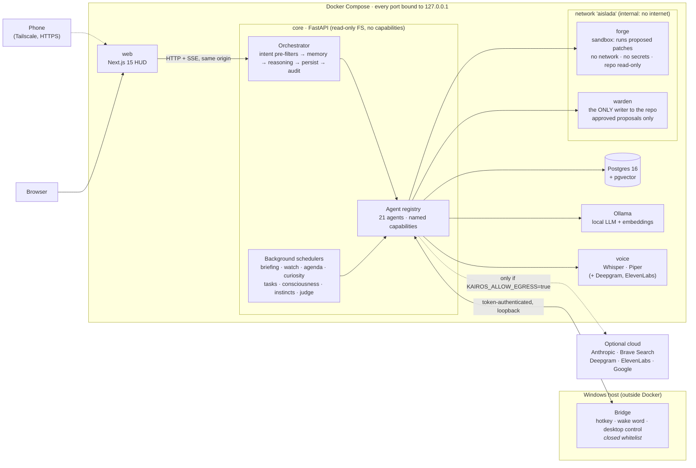

# KAIROS

https://github.com/user-attachments/assets/a8d38309-eaa0-48ab-875d-b1c7ae29d451

**A local-first, modular personal AI assistant.** It runs on my own machine,
talks and listens in real time, remembers what matters, controls my desktop
through a closed whitelist, and can propose changes to its own code — which it
tests in a sandbox and never applies without my approval.

21 agents (16 always on, 5 opt-in) · 327 automated tests · 77 architecture
decision records · Python / FastAPI · Next.js 15 · PostgreSQL + pgvector ·
Docker.

> **How this was built.** I designed the architecture and made every
> technical decision; I used Claude as a pair programmer for implementation.
> Every decision below is one I can defend, and [`docs/adr/`](docs/adr/)
> records the reasoning as it happened — including the calls I got wrong.

**Contents:** [Purpose](#purpose) · [What it does](#what-it-does) ·
[Architecture](#architecture) · [Installation](#installation) ·
[Usage](#usage) · [Testing](#testing) · [Benchmarks](#benchmarks) ·
[Limitations](#limitations) · [Design decisions](#key-design-decisions) ·
[Lessons](#problems-i-hit-and-how-i-solved-them) ·
[Documentation map](#documentation-map)

---

## Purpose

I wanted an assistant that knows *my* context — my class schedule, my notes,
my projects — instead of one that starts from zero every conversation. And I
wanted it running on my own hardware, because an assistant that knows your
life shouldn't send that life to someone else's server.

Existing assistants fail one of those two tests. Cloud ones don't run
locally; local ones don't know anything about you. KAIROS is built around one
foundational rule:

> **The internet adds capability; its absence degrades quality, never
> availability.** With the network down, KAIROS still answers (local model),
> still speaks (local TTS) and still remembers (embeddings are always
> computed locally — semantic memory never leaves the machine).

---

## What it does

| Capability | How |
|---|---|
| **Talks** | Wake word in the browser or on the desktop, streaming speech that starts before the model finishes. Cloud reasoning (Anthropic) with automatic fallback to a local model (Ollama) if the cloud fails before the first token. |
| **Remembers** | Curated semantic memory on pgvector (HNSW, cosine). A model decides what is a durable fact; near-duplicates (≥ 0.95 similarity) are ignored, updates (≥ 0.82) supersede the old fact. Nothing is ever hard-deleted. |
| **Acts** | Opens apps, arranges windows across two monitors, controls Spotify and screen brightness (DDC/CI). The model *chooses* from a closed list of declared actions; it never emits commands. |
| **Reads inbox and calendar** | Gmail and Google Calendar. Irreversible operations (send, delete) require explicit double confirmation. |
| **Indexes my notes** | Course PDFs chunked on paragraph boundaries with overlap and embedded, so answers come from my syllabus, not generic theory. |
| **Works in the background** | Long tasks are planned, written step by step, reviewed as a whole, and reported when done — while the conversation continues. |
| **Modifies itself, safely** | Reads its own source, writes whole files, computes the diff, runs the test suite in a network-less sandbox, fixes failures, and leaves a *proposal*. A separate service applies it only after I approve, and only if tests pass again on the merged result. |
| **Takes initiative** | Daily briefing, reminders, a watcher that reports regressions in its own health, and a "consciousness" agent that connects facts across time (*"you uploaded those physics notes on Tuesday and the exam is tomorrow — did you look at them?"*). All proactive features **warn; they never act**. |
| **Is reachable from my phone** | Over Tailscale with HTTPS inside the private network. No port is opened to the internet. |

---

## Architecture



### Repository layout

```
apps/
  core/      FastAPI service: orchestrator, agent registry, 21 agents, auth, audit, DB models
  web/       Next.js 15 / React 19 / TypeScript HUD: chat, voice session, panels
  voice/     Speech service: Whisper (STT) and Piper (TTS) locally; Deepgram / ElevenLabs optional
  bridge/    Windows process: global hotkey, always-on listener, desktop actions (whitelist only)
  forge/     Sandbox: applies a patch to a throwaway copy of the repo and runs the tests
  warden/    Applier: the only process allowed to write to the real repository
docker/      Dockerfiles and Postgres init (pgvector extension)
docs/        Architecture, decisions, 77 ADRs, threat model, mobile setup
benchmarks/  Reproducible benchmark suite and reference results
scripts/     Operational scripts: health check, self-repair, secrets, mobile HTTPS
```

**Every module, and why it exists, is explained in
[`docs/ARCHITECTURE.md`](docs/ARCHITECTURE.md).**

### A chat request, end to end

1. The browser posts to `/api/v1/chat/stream`; the session cookie is resolved
   against the `sessions` table.
2. The orchestrator loads the conversation and its last 10 turns.
3. `memory.retrieve` embeds the query **locally** and ranks memories by cosine
   distance **inside Postgres** (`<=>` on an HNSW index).
4. Deterministic intent pre-filters (regex, ~27 µs per message) decide
   whether the message is a reminder, a report request, a self-change
   request, a desktop order or plain conversation — in a fixed, documented
   order.
5. For conversation: notes and (if needed) web search are consulted, then
   `reasoning.respond_stream` streams tokens over Server-Sent Events.
6. Both messages are persisted; the exchange goes to `memory.ingest`, which
   decides *after* the user has the answer whether anything is worth
   remembering.
7. An `audit_log` row is written (metadata only, never content). The full
   **trace** — which agents ran, how long each took — is returned to the
   client and shown in the UI.

---

## Installation

### Requirements

| | Minimum | Notes |
|---|---|---|
| OS | Windows 11 + WSL2, or Linux | The desktop bridge is Windows-only; everything else runs on any Docker host. |
| Docker | Docker Desktop / Engine with Compose v2 | |
| RAM | ~8 GB free | Local 8B model + Postgres + Whisper. |
| GPU | Optional (NVIDIA + Container Toolkit) | Used by Ollama only. Without a GPU, delete the `deploy:` block of the `ollama` service in `docker-compose.yml`. |
| API keys | None required | Anthropic, Brave, Deepgram, ElevenLabs and Google are optional upgrades. |

### Steps

```bash
git clone https://github.com/didimacveg/kairos.git
cd kairos
make init        # copies .env.example to .env and generates the DB password and session secret
```

Edit `.env`. The defaults run **fully offline**. To enable the cloud model,
set `KAIROS_ALLOW_EGRESS=true` and `ANTHROPIC_API_KEY=...` — both are needed;
a key alone is never enough to leave the machine.

```bash
make up          # builds and starts postgres, ollama, voice, forge, warden, core, web
make models      # pulls llama3.1:8b and nomic-embed-text into Ollama
make user        # creates the owner account (interactive)
make estado      # checks that every service actually responds
```

Open <http://localhost:3000> and log in.

### Optional components

| Component | Enable with | Guide |
|---|---|---|
| Desktop bridge (Windows) | `KAIROS_BRIDGE_ENABLED=true` + `KAIROS_BRIDGE_TOKEN`, then run `apps/bridge/bridge.py` on the host | [`apps/bridge/INSTALAR.md`](apps/bridge/INSTALAR.md) |
| Self-modification | `KAIROS_FORGE_ENABLED`, `KAIROS_SMITH_ENABLED`, `KAIROS_WARDEN_ENABLED` + their tokens | [ADR 0026](docs/adr/0026-smith.md), [ADR 0027](docs/adr/0027-warden.md) |
| Gmail / Calendar | `KAIROS_GOOGLE_CLIENT_ID/SECRET`, then `python scripts/autorizar-google.py` | [ADR 0048](docs/adr/0048-gmail-y-calendar.md) |
| Phone access | Tailscale + `scripts/https-movil.sh` | [`docs/MOVIL.md`](docs/MOVIL.md) |

Agents that act on the outside world are **opt-in twice**: a flag *and* a
token. Without both, the agent is not even registered.

---

## Usage

| Command | What it does |
|---|---|
| `make up` / `make down` | Start / stop the stack (data persists in volumes). |
| `make estado` | Health check that calls each service instead of trusting `docker compose ps`. |
| `make curar` | Diagnoses **and repairs** what can be repaired (restarts dead containers), refuses if the code doesn't compile, never touches source. |
| `make explicar` | Explains why the last agent call failed, without opening five terminals. |
| `make logs` | Follows the core's structured logs. |
| `make test-todo` | Unit + startup + Postgres integration tests. |
| `make bench` / `make bench-live` | Benchmarks (see below). |

Things to say (the assistant's language is Spanish):

```text
"Kairos, entra en modo estudio"                 → runs a declared desktop profile
"Recuérdame el examen de física el jueves a las 8" → fixed reminder
"Avísame cuando juegue el Madrid"               → open reminder: it searches for the time itself
"Dame el informe de hoy"                        → on-demand briefing
"Hazme un trabajo sobre la fotosíntesis" + PDF  → background task, reported when done
"Proponte que el briefing incluya el tiempo"    → self-change proposal, tested in the sandbox
"Guarda esto como rutina 'empezar a estudiar'"  → replays the last actions by name later
```

The API is documented by FastAPI at <http://localhost:8000/docs> in
development mode.

---

## Testing

```bash
make test-todo    # unit + startup + Postgres integration (inside the core container)
```

Or, without Docker:

```bash
cd apps/core
pip install -e ".[dev]"
pytest -q          # integration tests that need Postgres error out without it
```

327 test cases: 321 unit/startup tests that run anywhere, plus 6 that run
against a real Postgres. **The startup tests are the ones that matter.** They
build the whole system, verify the router only imports routes that exist on
disk, check that SQLAlchemy resolves every mapper, confirm no scheduler exists
without being launched, and reject undefined names (ruff F821) — the exact
failure classes that took KAIROS down in the past.

---

## Benchmarks

Benchmarks live in [`benchmarks/run.py`](benchmarks/run.py) and come in two
suites, because they answer different questions.

### Offline — what does KAIROS itself cost?

CPU-bound hot paths of the core, measured with zero-latency fake models, a
fixed random seed, warmup iterations and 500 timed repetitions. Needs only
the Python package: no Docker, no models, no network.

```bash
pip install -e apps/core
python benchmarks/run.py offline --repeat 500 --warmup 50 --json benchmarks/results/offline.json
# or, inside the running stack:
make bench
```

Reference results (commit `10013015c1`, Python 3.13, Linux x86-64, 4 vCPUs;
raw data in [`benchmarks/results/offline-reference.json`](benchmarks/results/offline-reference.json)):

| Case | Median | p95 | What it measures |
|---|---:|---:|---|
| Intent routing | 27 µs / message | 30 µs | All deterministic pre-filters on a 96-message mixed corpus |
| Prompt assembly | 23 µs | 46 µs | System prompt + 6 memories + 10 history turns + 5 web sources (8.4k chars) |
| Document chunking | 0.34 ms | 0.41 ms | 20,000 words of notes → 185 paragraph-aligned chunks |
| Patch generation | 1.37 ms | 1.52 ms | Whole-file rewrite of a 900-line module → unified diff (`difflib`) |
| Streaming overhead | 2.4 µs / token | 2.7 µs | Agent + event wrapping per streamed token |
| Failover path | 7.1 µs | 11.9 µs | Extra time-to-first-token when the cloud fails instantly and the local model takes over (vs 3.5 µs direct) |

**Reading these numbers:** KAIROS's own overhead per message is tens of
microseconds; perceived latency is dominated entirely by the model, speech
and network. One finding worth stating: **71 % of the corpus passes the
cheap `huele_a_orden` gate**, so with the desktop bridge enabled most
messages pay one extra model round-trip for intent classification. That is a
deliberate trade-off ("when in doubt, classify" —
[ADR 0037](docs/adr/0037-latencia.md)), and the benchmark makes its cost
visible.

### Live — what does the user feel?

Against a running stack, the live suite measures time-to-first-token and
total time of `/api/v1/chat/stream`, a per-agent breakdown taken from the
trace events the core already streams (memory retrieval, reasoning, search…),
and time-to-audio of `/api/v1/voice/speak`.

```bash
export KAIROS_BENCH_USER=<owner> KAIROS_BENCH_PASSWORD=<password>
python benchmarks/run.py live --url http://127.0.0.1:8000 --runs 10 --json benchmarks/results/live.json
# or: make bench-live
```

These numbers depend on hardware, model and network, so they are not quoted
here from a machine that isn't yours. The live suite writes three short
messages to a dedicated conversation, which the memory curator will see like
any other exchange.

---

## Limitations

Honest boundaries of the current system:

- **Single user, single machine.** One owner account; the `role` column
  exists, multi-user does not. Agents run in-process; the registry is designed
  to return network proxies later, but no remote transport exists yet.
- **Spanish-first.** Prompts, intent pre-filters (regex) and the UI are in
  Spanish. Speaking English works for conversation; desktop orders and
  reminders are only recognised in Spanish.
- **Regex pre-filters are brittle by nature.** They are explicit and fast,
  but phrasing outside the patterns falls through to conversation or to the
  model classifier.
- **The desktop bridge is Windows-only** (window management, DDC/CI
  brightness, global hotkey). The rest of the stack is OS-independent.
- **No schema migrations.** The schema is created at startup
  (`create_schema`); changing a column on an existing database is manual.
- **No CI pipeline in this repository.** Tests run locally through `make
  test-todo` and in the forge/warden before any self-modification is applied.
- **Local model quality.** The fully offline mode uses an 8B model. It keeps
  the system available, but answers, memory extraction and intent
  classification are noticeably worse than with the cloud model.
- **Background schedulers live in the core process.** If the PC is off,
  briefings, reminders and the watcher are off too (a low-power always-on node
  is on the roadmap).
- **Self-modification is supervised by design.** Fully autonomous changes are
  deliberately not built; every patch needs a human approval.
- **Proactive features depend on hard-coded schedule constants** (school
  hours, quiet hours) tuned to my week rather than to a configurable profile.

---

## Key design decisions

Full reasoning in [`docs/DECISIONS.md`](docs/DECISIONS.md) and
[`docs/adr/`](docs/adr/). The ones that shaped everything else:

**Postgres, not SQLite.** Semantic memory needs vector similarity search.
SQLite has no native vector type; pgvector gives HNSW indexing and cosine
distance as a first-class operator. The alternative was computing similarity
in Python over every stored memory — O(n) per query, degrading exactly when
memory becomes useful.

**Agents, not one large prompt.** A single prompt handling voice, memory,
desktop control and search would need every instruction in every call, and
models apply rules worse as prompts grow. Agents also isolate failure: when
the voice service dies, the reasoning agent doesn't know or care.

**The core never runs code it wrote.** The core process holds API keys and
database credentials. Generated code runs in a sandbox with no internet, a
read-only copy of the repo, and nothing worth stealing. A different service —
the only one with write access — applies approved changes.

**Whole files, not diffs.** Language models produce broken unified diffs
constantly — wrong line numbers, mismatched context. Asking for the complete
resulting file and computing the diff with `difflib` means the patch is either
valid or nonexistent, never "almost valid."

**Proactive features warn, they don't act.** The watcher can report the bridge
has been down for two hours. It cannot restart it. A system that fixes itself
is one that eventually decides your work session is the problem.

---

## Problems I hit, and how I solved them

**A model that wouldn't write tests.** Three rounds of stricter prompting
failed. The realisation: asking for code and tests in one response splits the
model's attention and tests always lose — it has mentally "finished" by the
time it gets there. A dedicated call with one job produced them immediately.
→ [ADR 0050](docs/adr/0050-smith-en-segundo-plano.md)

**A search that lied for months.** DuckDuckGo started returning HTTP 202 with
its homepage instead of results. The parser extracted zero and the agent
returned `ok=True` with an empty list, so the system said "I don't have
current information" while search was enabled. Nobody noticed because that
response is plausible. **A component that fails by returning success is worse
than one that crashes.** Search now uses the Brave API, which returns real
status codes. → [ADR 0074](docs/adr/0074-busqueda-que-no-miente.md)

**Five outages that unit tests couldn't catch.** `Mapped[Any]` without
importing `Any` passes every syntax check and crash-loops the container —
SQLAlchemy resolves annotations when configuring mappers, not at import. I had
hundreds of tests and none of them built the whole system. Ten lines of
startup test would have caught all five.
→ [ADR 0063](docs/adr/0063-tests-de-arranque.md)

**An animation I rewrote nine times.** I kept adjusting *when* each element
appeared. The problem was that two of them occupied the same *place* — the
pulsing core sat exactly where the wordmark would land. Optimising timing
never fixes a layout problem.
→ [ADR 0070](docs/adr/0070-el-nucleo-no-vive-en-el-centro.md)

### What I'd do differently

- **Write the startup tests first.** They're ten lines and would have
  prevented every outage I had. I wrote them at phase 63 of 76.
- **Never pattern-substitute inside large files.** Regex edits on a 900-line
  orchestrator broke this repository more times than any other single cause.
- **Treat "not applied" warnings as failures.** My patch scripts printed a
  warning when a substitution didn't match, and I treated those as
  information rather than errors. Several features shipped half-applied for
  weeks.

---

## Documentation map

| Document | Contents |
|---|---|
| [`docs/ARCHITECTURE.md`](docs/ARCHITECTURE.md) | Every module, what it does and why it exists |
| [`docs/DECISIONS.md`](docs/DECISIONS.md) | The reasoning behind the architecture, for first-time readers |
| [`docs/adr/`](docs/adr/) | 77 architecture decision records, one per decision (Spanish) |
| [`docs/threat-model.md`](docs/threat-model.md) | Assets, adversaries and mitigations |
| [`docs/MOVIL.md`](docs/MOVIL.md) | Phone access over Tailscale with HTTPS |
| [`docs/ROADMAP.md`](docs/ROADMAP.md) | What's next and what is deliberately not built |
| [`CONTRIBUTING.md`](CONTRIBUTING.md) | How changes are proposed and verified |

## Roadmap

See [`docs/ROADMAP.md`](docs/ROADMAP.md). Next up: telephony, hand tracking,
and a low-power always-on node so the watcher and briefings survive shutting
down the PC.

Deliberately not built: fully autonomous self-modification, and multi-user
support. Both are in the roadmap with the reasoning.

## License

MIT. See [LICENSE](LICENSE).
