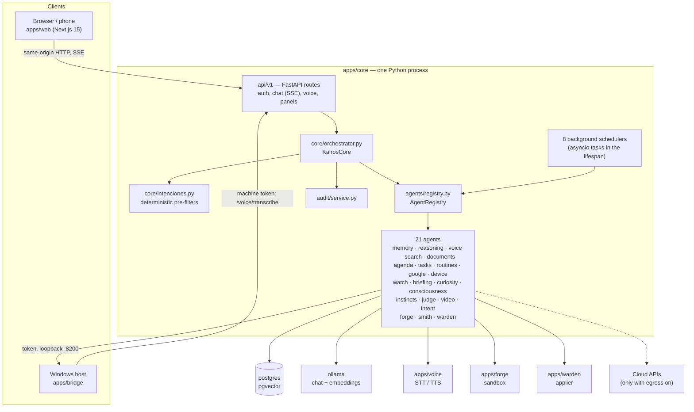
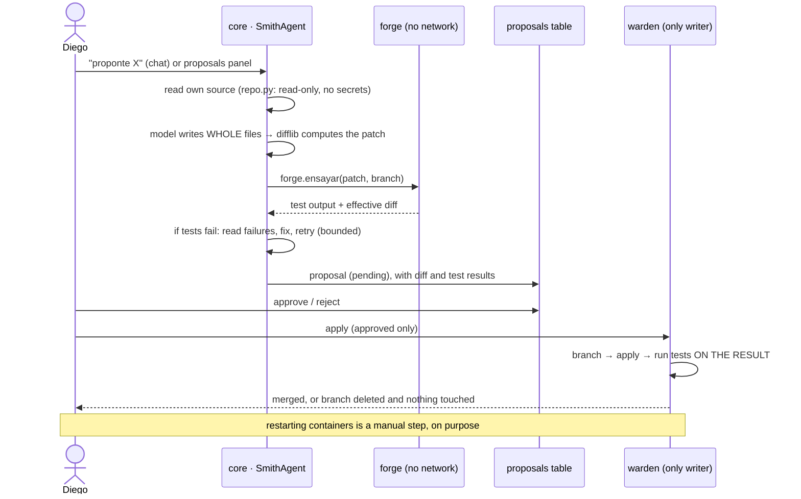

# KAIROS architecture

This document explains every module of the repository: what it does, and —
more importantly — **why it exists**. The governing principle has not
changed since phase 1:

> An architectural boundary only exists if it separates real
> responsibilities. Every abstraction here has to justify itself; if it
> can't, it gets deleted.

For the history behind each decision, follow the ADR links: the
[`adr/`](adr/) directory holds 77 records (written in Spanish, as the
project was built).

**Contents**

1. [System view](#1-system-view)
2. [Trust boundaries](#2-trust-boundaries)
3. [The core (`apps/core`)](#3-the-core-appscore)
   - [Agent contract and registry](#31-agent-contract-and-registry)
   - [Composition root](#32-composition-root-corebootstrappy)
   - [Orchestrator and intent routing](#33-orchestrator-and-intent-routing)
   - [Agents, one by one](#34-agents-one-by-one)
   - [Background schedulers](#35-background-schedulers)
   - [API layer](#36-api-layer)
   - [Persistence](#37-persistence)
   - [Auth and audit](#38-auth-and-audit)
   - [Config, prompts, logging, CLI](#39-config-prompts-logging-cli)
4. [Satellite services](#4-satellite-services)
5. [The web interface (`apps/web`)](#5-the-web-interface-appsweb)
6. [Infrastructure and operations](#6-infrastructure-and-operations)
7. [Cross-cutting flows](#7-cross-cutting-flows)
8. [What deliberately does not exist](#8-what-deliberately-does-not-exist)
9. [Known inconsistencies](#9-known-inconsistencies)

---

## 1. System view

Six containers plus one host process:

| Unit | Runs | Network | Filesystem | Why it is separate |
|---|---|---|---|---|
| `postgres` | pgvector/pg16 | default | volume | Vector search must happen in the database, not in Python. |
| `ollama` | local LLM + embeddings | default | volume | The local model is the availability guarantee; GPU lives here. |
| `voice` | Whisper + Piper (+ remote providers) | default, no published port | repo `apps/voice` read-only | Speech is CPU-heavy and bursty; it must not block the event loop of the core. |
| `forge` | patch + tests on a throwaway copy | `aislada` (internal, no internet) | repo read-only | Runs untrusted, model-written code. |
| `warden` | merge approved patches | `aislada` | repo **read-write** | The only writer to the repository; kept tiny on purpose. |
| `core` | FastAPI + agents + schedulers | default + `aislada` | **read-only root**, repo read-only, `cap_drop: ALL` | Holds the secrets; never executes generated code. |
| `web` | Next.js dev server | default | source mounted | UI; proxies to the core so cookies stay `SameSite=Strict`. |
| bridge (host) | Python on Windows | loopback only | user config | Only a host process can see monitors, register a global hotkey and launch apps. |

---

## 2. Trust boundaries

The architecture is easiest to understand as a set of nested trust zones,
each holding less than the one before it:

1. **The core** holds API keys, the database credential, bridge/forge/warden
   tokens. Therefore it **never runs code it wrote**, never builds shell
   strings, and its filesystem is read-only. It can *read* the repository
   (Smith needs to see its own code) but not write to it.
2. **The forge** runs model-written code. Therefore it has **nothing worth
   stealing** — no secrets, no internet (internal Docker network), a
   read-only mount of the repo that it copies to a temp dir, memory and PID
   limits, all Linux capabilities dropped.
3. **The warden** can write to the repository. Therefore it knows exactly
   four operations (branch, apply, test, merge), demands an approved proposal
   (checked by the core *and again* by the warden), and never restarts
   anything: the restart is the irreversible moment, and a human does it.
4. **The bridge** can act on the desktop. Therefore it executes only
   profiles and actions **declared by the user** in `bridge-config.json`;
   there is no endpoint that accepts a command, and `subprocess` is always
   called with an argument list and `shell=False`.
5. **The model** is never trusted to emit actions. It *chooses* from a closed
   list (`IntentAgent`), and anything not on the list is discarded before it
   leaves the core.

Egress is a single master switch (`KAIROS_ALLOW_EGRESS`). With it off, the
reasoning agent refuses non-local providers even if a key is configured, and
the search agent refuses to query ("búsqueda bloqueada"). Embeddings are computed
locally **under every configuration**: semantic memory is the most sensitive
data in the system.

See [`threat-model.md`](threat-model.md) for assets and adversaries.

---

## 3. The core (`apps/core`)

### 3.1 Agent contract and registry

**`agents/base.py`** — the contract every agent implements:

- `Agent.handle(AgentRequest) -> AgentResponse`. An agent **never raises**;
  failures are `AgentResponse.failure(msg)`. This keeps one broken agent from
  taking down a request that only partly depends on it.
- `AgentRequest` carries a `capability` name (`memory.retrieve`), an actor,
  a correlation id and a payload. `AgentResponse` carries `ok`, `data`,
  `error` and a list of `TraceEvent`s.
- `TraceEvent` is **not logging**: it is returned to the client and shown in
  the UI, so the user can see what KAIROS did to produce an answer.
- `StreamingAgent` is a separate `Protocol` with `handle_stream`, implemented
  only by agents whose output is incremental. Forcing every agent to return a
  generator would complicate agents that return one value.

*Why it exists:* the real risk in a multi-year personal project is not
latency but coupling — voice, memory and automation ending up in one file.
The contract makes each agent a bounded context that owns its state and never
imports another agent's internals. ([ADR 0003](adr/0003-agentes-en-proceso.md))

**`agents/registry.py`** — `AgentRegistry`: register by unique name, look up
by name or by capability (`find("memory.retrieve")`).

*Why it exists:* it replaces service discovery. Today every agent is
in-process; when one has to run on another machine, the registry can return
a network proxy with the same contract and no caller changes.

### 3.2 Composition root (`core/bootstrap.py`)

The **only** file that decides what KAIROS is made of. It builds the LLM
provider and registers every agent.

Provider selection, in order:

1. `KAIROS_PROVIDER_MODE=local` → Ollama.
2. Egress disabled → Ollama (a key alone is not enough).
3. No Anthropic key → Ollama.
4. Otherwise → `FailoverProvider(preferred=Anthropic, fallback=Ollama)`.

Agents that act on the outside world are **double opt-in** (flag + token)
and are simply not registered otherwise: `DeviceAgent` (desktop),
`ForgeAgent` (sandbox), `SmithAgent` (requires the forge too — "a patch that
wasn't tested is not a proposal, it's a bet"), `WardenAgent` (repository
writes). `SearchAgent` is on by default but can be disabled.

*Why it exists:* wiring scattered across modules is how systems become
impossible to reason about. One file answers "what is running?".

### 3.3 Orchestrator and intent routing

**`core/orchestrator.py`** — `KairosCore`, deliberately boring. It defines
the *order* of a turn and guarantees nothing skips the audit; all
intelligence lives in agents.

- `chat()` — full response at once (kept for debugging with `curl`).
- `chat_stream()` — the real path: yields `StreamEvent`s (`token`, `trace`,
  `end`, `error`) that the API turns into Server-Sent Events.

Order inside a streamed turn:

1. Load/create the conversation and its last 10 turns (`HISTORY_TURNS`).
2. `memory.retrieve` → top-k memories (emitted as a trace event immediately).
3. Deterministic short-circuits, **first match wins**: reminder → report →
   save-routine → self-change request → desktop order. Each one answers
   directly, persists the turn and ends the stream without a generation.
4. Otherwise: consult indexed notes, web search if
   `probably_needs_search()`, then `reasoning.respond_stream`.
5. Persist both messages, then `memory.ingest` on the full exchange.
6. Audit.

**Streaming guarantee:** if the stream breaks midway, the failure is audited
but **nothing is written to semantic memory** — a truncated memory pollutes
every future retrieval, and a memory with garbage is worse than an empty one.

**`core/intenciones.py`** — the deterministic detectors
(`peticion_de_cambio`, `encargo`, `pide_informe`, `peticion_de_aviso`,
`huele_a_orden`) and the `ORDEN` tuple that documents which one wins.

*Why it exists:* the detectors used to live as static methods inside a
937-line orchestrator, each with slightly different normalisation, and the
precedence was implicit in the order of `if`s. Pulled together, both the
shared normalisation and the precedence are visible. The governing rule:
**explicit preamble, never interpretation** — talking *about* reminders is
not creating one. `huele_a_orden` is the exception by design: a permissive
gate ("when in doubt, classify") in front of the model-based
`IntentAgent`. ([ADR 0037](adr/0037-latencia.md))

### 3.4 Agents, one by one

Grouped by role. *Caps* are the capability names each agent exposes.

#### Conversation

| Agent | Caps | What it does | Why it exists |
|---|---|---|---|
| **Reasoning** (`agents/reasoning/`) | `reasoning.respond`, `reasoning.respond_stream` | Builds the prompt (style rules → identity → current date/time → web sources → memories → history → message) and calls the provider, whole or streamed. Refuses remote providers when egress is off. | One place that talks to the model for conversation. Style rules go *first* because models apply rules worse when they arrive after the concrete problem. Spoken and written answers get different rules (formatting is ridiculous when read aloud). |
| ↳ `providers/` | — | `base.py` (contract: `complete`, `complete_stream`, `embed`, `available`), `ollama.py`, `anthropic.py`, `failover.py`. | `FailoverProvider` keeps the foundational rule alive: if the cloud fails **before the first token**, the request transparently retries locally. If it fails *after* tokens were emitted, it propagates the error — retrying would duplicate text on screen. Embeddings always go local. |
| **Memory** (`agents/memory/`) | `memory.retrieve`, `memory.ingest`, `memory.store` | Retrieval: embed locally, cosine search in Postgres (HNSW), filter by minimum similarity. Ingestion: extract durable facts (`extractor.py`), then dedupe (≥ 0.95 → ignore), supersede (≥ 0.82 → mark old as superseded), else insert. `audit.py` classifies legacy memories for clean-up, only with explicit `apply=True`, and only by status change, never `DELETE`. | Memory used to be a log of every user message — questions and requests competed with real facts in every search. A request is not a fact about the user. Curation runs *after* the user has the answer, so it adds no perceived latency. ([ADR 0007](adr/0007-memoria-curada.md)) |
| **Documents** (`agents/documentos/`) | `documentos.indexar`, `.buscar`, `.listar`, `.borrar` | Indexes PDFs/text: paragraph-aligned chunks (~1,400 chars, 250 overlap, max 600 chunks), each prefixed with the document title, embedded locally, searched by similarity. | So KAIROS answers from *my* syllabus and notation. Splitting by characters cuts concepts in half; the title prefix tells the model which subject a lone chunk belongs to. ([ADR 0051](adr/0051-memoria-documental.md)) |
| **Search** (`agents/search/`) | `search.web` | Brave Search API (`brave.py`) when `KAIROS_BRAVE_KEY` is set — a failure is reported as a failure, never as an empty success — with the original HTML parser kept as a keyless fallback; `probably_needs_search()` is the heuristic that decides whether a turn needs it. Every query is traced with the exact sources. | No model knows today's eclipse time. The move to Brave came from a scraper that silently returned `ok=True` with zero results for months: **a component that fails by returning success is worse than one that crashes.** ([ADR 0074](adr/0074-busqueda-que-no-miente.md)) |
| **Intent** (`agents/intent/`) | `intent.classify` | Given the available actions and declared profiles, the model returns JSON naming **one action from the list**; anything else is discarded during validation. | Regex recognised "abre el perfil trabajo" but not "entra en modo trabajo". The fix was not letting the model execute — it was letting it *choose* from fixed buttons. |
| **Voice** (`agents/voice/`) | `voice.transcribe`, `voice.speak` | Thin HTTP client to the `voice` container. | First agent whose work happens outside the core process, proving that the contract is transport-agnostic. |

#### Acting on the world

| Agent | Caps | What it does | Why it exists |
|---|---|---|---|
| **Device** (`agents/device/`) | `device.profile`, `.focus`, `.close`, `.status`, `.music`, `.app`, `.say`, `.brillo`, `.open_urls` | Asks the Windows bridge for actions **by name**. Closing windows requires explicit confirmation. | "A remote control with fixed buttons, not a terminal." A hallucinated profile gets "profile not declared" and nothing happens. |
| **Google** (`agents/google/`) | `google.correo_buscar`, `.correo_enviar`, `.correo_leido`, `.agenda_proximos`, `.agenda_crear`, `.agenda_borrar` | Gmail and Calendar via OAuth (`auth.py`, `gmail.py`, `calendar.py`); `vigilante.py` watches the inbox for important mail. | Sending and deleting are the least reversible actions in the system, so `confirmar` is checked in the agent **and** in the route. ([ADR 0048](adr/0048-gmail-y-calendar.md), [ADR 0059](adr/0059-avisos-de-correo.md)) |
| **Agenda** (`agents/agenda/`) | `agenda.crear`, `.listar`, `.resolver` | Reminders. *Fixed* ("Thursday at 8") are scheduled; *open* ("when Madrid plays") are resolved by searching the web, then converted to fixed, retried later if not found. | Lets KAIROS act in my absence. Rule: a reminder announces, it never executes. ([ADR 0041](adr/0041-agenda.md)) |
| **Tasks** (`agents/tareas/`) | `tareas.crear`, `.listar`, `.ejecutar` | Background jobs: plan → write step by step carrying the plan and prior output → review the whole → notify. | A model writing 3,000 words in one go loses the thread halfway; with the plan in front of each step, every part fits. ([ADR 0049](adr/0049-tareas-en-segundo-plano.md)) |
| **Routines** (`agents/rutinas/`) | `rutinas.guardar`, `.ejecutar`, `.listar`, `.borrar` | "Save the last ten minutes as 'start studying'": reads the audit log, keeps only executed capabilities, replays them by name. Never replays sending mail or deleting events. | The audit already records every capability; a routine is just a named sequence of them — no screen recording needed. ([ADR 0077](adr/0077-rutinas.md)) |
| **Video** (`agents/video/`) | `video.analizar`, `video.cortes` | ffmpeg extracts audio → Deepgram transcribes with timestamps → the model picks the best moments → returns ready-to-run cut commands. **Does not run them.** | The value is compressing, not generating. A miscalculated cut on the original file is unrecoverable, so KAIROS returns commands instead. The video folder is mounted read-only. ([ADR 0080](adr/0080-video.md)) |

#### Initiative (the system speaks first)

| Agent | Caps | What it does | Why it exists |
|---|---|---|---|
| **Briefing** (`agents/briefing/`) | `briefing.generate` | Daily summary at a configured time (date, weather via search, system state, memories). **Persisted before it is spoken.** | If I'm not home, the audio is lost but the text waits in the UI. A warning that only exists while it plays is noise. |
| **Watch** (`agents/watch/`) | `watch.revisar` | Every N minutes checks agent health, approved-but-unapplied proposals, egress turned on, disk filling up. Reports only changes for the worse, never repeats. | **Warns, never acts.** A system that fixes itself eventually decides your work session is the problem. ([ADR 0034](adr/0034-vigilancia-proactiva.md)) |
| **Curiosity** (`agents/curiosidad/`) | `curiosidad.revisar` | Looks at my interests in memory, searches for news, and **judges** whether something is worth interrupting for; opens with a question rather than the whole story. | Separates an assistant from a chatbot on a timer: the point is deciding *whether* to speak. ([ADR 0047](adr/0047-iniciativa.md)) |
| **Consciousness** (`agents/consciencia/`) | `consciencia.revisar` | Looks *inward* (calendar, notes, tasks, proposals) and reasons over the **timeline**: an observation must depend on *when* things happened. Brakes: school hours, quiet hours, a daily cap, never comment on something from today, never repeat a key within days. | "You have an exam Thursday" adds nothing; "you uploaded physics notes two days ago and the exam is tomorrow" does. ([ADR 0061](adr/0061-consciencia.md)) |
| **Instincts** (`agents/instintos/`) | `instintos.aprender`, `.consultar` | Nightly, mines the last 30 days of audit for repeated patterns (same hour, same weekday, actions that follow each other), each with a confidence score; low confidence is only observed. | Learning habits without being told. Confidence matters more than the pattern: seen twice is coincidence, fifteen times is a habit. ([ADR 0078](adr/0078-instintos.md)) |
| **Judge** (`agents/juez/`) | `juez.evaluar`, `.tendencia` | Nightly, scores a sample of ten answers on correctness, usefulness, brevity and voice; reports only when the trend drops. | Tests verify code; nothing verified the quality of what KAIROS *says*. A 7 after three weeks of 8s means something broke, and the dates show what changed. ([ADR 0079](adr/0079-juez-e-introspeccion.md)) |

#### Self-modification

| Module | What it does | Why it exists |
|---|---|---|
| **Smith** (`agents/smith/agent.py`) | The proposal loop above. Tests are generated in a **dedicated call**, not together with the code. | Asked for code and tests in one response, the model always dropped the tests. ([ADR 0026](adr/0026-smith.md), [0050](adr/0050-smith-en-segundo-plano.md), [0057](adr/0057-smith-cierra-el-ciclo.md)) |
| `smith/diffs.py` | Parses the model's answer (plain-text file markers, not JSON) and builds the unified diff with `difflib`. | Model-written diffs fail constantly; Python files inside JSON require escaping every quote. With markers there is nothing to escape. ([ADR 0029](adr/0029-formato-de-smith.md)) |
| `smith/repo.py` | Read-only, bounded view of the repository: rejects paths escaping the tree (after resolving symlinks and `..`), excludes secrets by pattern, skips binaries and dependencies. | The context may go to a remote model; a key inside it is a leaked key. |
| **Proposals** (`agents/proposals/store.py`) | Proposal queue with explicit states: pending → approved → applied / failed; rejected; expired after 7 days. | Approving is a judgment; applying is an operation that can fail. If they shared a state, a failed merge would look applied. |
| **Forge** (`agents/forge/agent.py`) | Client of the forge service: `forge.ensayar`. | The core never executes proposed code. |
| **Warden** (`agents/warden/agent.py`) | Client of the warden service: `warden.aplicar`. Re-checks the approval before calling. | Two locks on the only path that writes to the real repository. |

### 3.5 Background schedulers

Eight `asyncio` tasks started in the FastAPI `lifespan` (`main.py`) and
cancelled on shutdown. Each lives next to its agent as `scheduler.py`:

| Scheduler | Cadence | Reason for the cadence |
|---|---|---|
| briefing | checks every minute, fires once a day | Idempotent by stored date; a `while` + `sleep` is easier to debug than a scheduling library for one job a day. |
| agenda | due reminders every minute; open reminders every 30 min | Being late makes a reminder useless; web searches cost. |
| watch | every `KAIROS_WATCH_INTERVAL` (20 min) | Useful watching reports what has been wrong *for a while*. |
| curiosity | every 2 h | Finding something notable every two hours means it's filling, not judging. |
| consciousness | every 90 min | Relations between facts change over hours, not minutes. |
| tasks | continuous queue, **one task at a time** | Two long tasks in parallel compete for the same provider and the cost explodes unseen. |
| instincts, judge | nightly | Usage patterns and answer quality change over weeks. |

*Why in-process and not cron/Celery:* there is one user and one machine; a
queue would add a broker and a failure mode without solving a problem. The
startup tests verify that no scheduler exists without being launched.

### 3.6 API layer

`api/v1/router.py` mounts one router per area under `/api/v1`: `auth`,
`chat` (whole + SSE stream), `conversaciones`, `voice`, `files`,
`documentos`, `tareas`, `rutinas`, `briefing`, `proposals`, `smith`,
`warden`, `device`, `google`, `intent`, `juez`, `video`, `health`. Schemas
live in `schemas.py`.

Notable details:

- The SSE route opens **its own DB session inside the generator**: FastAPI
  closes `yield` dependencies before a `StreamingResponse` body is consumed,
  so an injected session would be dead exactly when it's needed.
- Streams always end in `end` or `error`, never in silence: the client must
  distinguish "finished" from "connection dropped". Proxy buffering is
  disabled with `X-Accel-Buffering: no`.
- `main.py` adds CORS for the configured origins, trusted hosts (`localhost`,
  `*.local`, `*.ts.net`), proxy headers (Tailscale Serve terminates TLS), and
  strict security headers (`CSP default-src 'none'`, `X-Frame-Options:
  DENY`). OpenAPI docs exist only in development.

### 3.7 Persistence

**`db/models.py`** — SQLAlchemy 2 typed models. Tables: `users`, `sessions`,
`conversations`, `messages`, `memory_items` (text + `vector` embedding +
status: active / superseded / discarded), `documents`, `document_chunks`,
`attachments`, `reminders`, `tasks`, `routines`, `instincts`, `evaluations`,
`briefings`, `proposals`, `audit_log`.

**`db/bootstrap.py`** — `create_all` plus the pgvector extension, HNSW
indexes and a trigger that makes `audit_log` append-only at the database
level. No Alembic yet: the schema changed daily
([ADR 0004](adr/0004-esquema-sin-alembic-en-fase-1.md)).

**`db/session.py`** — async engine (asyncpg) and session factory with
`expire_on_commit=False`, so objects stay usable after the request session
closes (needed by the SSE route).

*Why Postgres:* see the README — vector search must be a database operator,
not an O(n) Python loop.

### 3.8 Auth and audit

| Module | What it does | Why |
|---|---|---|
| `auth/security.py` | Argon2id password hashing, above OWASP minimums. | Calibrated so a login takes ~200 ms on desktop hardware. |
| `auth/service.py` | Authenticate, issue and revoke sessions (random token, hashed in DB, TTL). | Server-side sessions can be revoked; a stateless token can't. |
| `auth/deps.py` | `CurrentUser`, `DbSession` FastAPI dependencies; cookie `HttpOnly`, `SameSite=Strict`, `Secure` when served over HTTPS. | One place that decides who is calling. |
| `auth/machine.py` | Machine credential for the bridge: the same shared token, valid **only** for `/voice/transcribe`. | A compromised bridge can transcribe audio; it cannot read conversations. Better than storing the owner's password on Windows. |
| `audit/service.py` | Every authentication, memory read/write and model call writes a row: action, outcome, actor, resource, correlation id, metadata. **Never content.** | Content already lives in `messages`; duplicating it widens exposure without adding information. The audit is also the raw material for routines and instincts. |

### 3.9 Config, prompts, logging, CLI

- **`config.py`** — one `pydantic-settings` object; every setting has an
  `KAIROS_*` env alias and a safe default (egress off, everything bound to
  loopback, dangerous agents disabled).
- **`prompts/base.py`** — KAIROS's identity and the written/spoken style
  rules, composed in front of every agent prompt. Changing how it speaks is a
  change in one place, not eight.
- **`logging.py`** — `structlog` JSON logs, keyed events
  (`provider.selected`, `provider.failover`, …).
- **`cli.py`** — `migrate` and `create-user` (used by `make migrate` /
  `make user`).

### Tests (`apps/core/tests`)

327 test cases in 35 files. Unit tests use deterministic fakes
(`conftest.py`: `FakeProvider` with configurable chunks and failure point,
deterministic embeddings). Two files matter more than the rest:

- `test_integracion_arranque.py` — builds the whole system, imports the app
  exactly like uvicorn, configures every SQLAlchemy mapper, checks that the
  router only imports routes present on disk, that every scheduler is
  launched, and that there are no undefined names. Each test corresponds to a
  real outage. ([ADR 0063](adr/0063-tests-de-arranque.md))
- `test_integracion_memoria.py` — against a real, ephemeral Postgres: vector
  recall order, per-user isolation, retired memories not returned, audit
  append-only enforced by the trigger, HNSW index present.

---

## 4. Satellite services

### `apps/voice` — speech service

FastAPI service with no published port (reachable only inside Docker).

- **STT:** `faster-whisper`, two models — `base` for short segments (< 60 KB,
  always commands) and `medium` for real sentences — on CPU, so the GPU is
  reserved for reasoning. Low-confidence and no-speech results are flagged,
  not guessed. Deepgram Nova-3 (`deepgram.py`) is an optional remote STT.
- **TTS:** one contract, several providers (`tts.py`), tried in order
  ElevenLabs → Deepgram Aura → **Piper (always last)**. If the remote
  providers fail, KAIROS still speaks — worse, but it speaks.
  ([ADR 0045](adr/0045-capa-de-voz.md))
- **Budget (`presupuesto.py`):** the free ElevenLabs tier is ~10 minutes of
  audio a month. The good voice is reserved for wake-up, urgent warnings and
  recordings; the monthly count is stored on disk so a restart doesn't
  "give back" quota. ([ADR 0046](adr/0046-presupuesto-de-voz.md))

*Why separate:* Whisper and Piper are CPU-heavy bursts; inside the core they
would stall every other request. It also proved the agent contract works
across a process boundary.

### `apps/forge` — sandbox

Copies the read-only repository to a temp dir, creates a branch, applies a
unified patch, runs the test suite, returns output and effective diff, and
deletes the temp dir. Four operations, no endpoint that accepts a shell
string, bearer-token protected, no internet, 2 GB / 512 PIDs limits.

*Why:* it is the only component that executes model-written code, so it has
the strictest threat model in the project.

### `apps/warden` — applier

Branch from current state → apply approved patch → run tests **on the
result** → merge into the main branch if green, otherwise delete the branch
and touch nothing. Requires `aprobada=true` again, regardless of what the
core says. Does not restart containers.

*Why:* someone must apply approved changes, and it can be neither the core
(it has your keys) nor the forge (it runs unverified code).
([ADR 0027](adr/0027-warden.md))

### `apps/bridge` — Windows host process

The only component outside Docker.

| File | Role |
|---|---|
| `bridge.py` | Local HTTP API on 127.0.0.1:8200 (token-authenticated) for the core's `DeviceAgent`; global hotkey (Win+Shift+K); tray icon. |
| `actions.py` | Every desktop action, all **declared in `bridge-config.json`**: launch and place apps per monitor/slot, focus, close, brightness over DDC/CI. No `os.system`, no `shell=True`. |
| `listener.py` | Always-on listener: wake word with fuzzy variants, recording ends on silence (not on a timer), continuously recalibrated noise threshold (median of recent quiet blocks), one-minute follow-up window without repeating the wake word. |
| `commands.py` | Fast path: only **unambiguous** patterns, 0 ms, no network; everything else goes to the core's intent classifier. |
| `speech.py` | Plays WAVs from the same voice service (`winsound`, stdlib) — no second TTS engine. |
| `spotify.py`, `autorizar-spotify.py` | Spotify Web API control (opening a URI doesn't guarantee playback from the start). |
| `diagnostico.py` | Microphone and core-connection diagnostics. |

*Why the whitelist:* prompt injection succeeds a meaningful fraction of the
time against any model. The defence cannot be "the model behaves"; it has to
be that **it can't** do anything undeclared.

---

## 5. The web interface (`apps/web`)

Next.js 15 / React 19 / TypeScript, plain CSS
([ADR 0005](adr/0005-css-plano-en-fase-1.md)). All requests go to the same
origin and Next.js rewrites them to the core: the session cookie stays
`SameSite=Strict` and there is no CORS surface.

| Module | Role |
|---|---|
| `app/page.tsx`, `app/layout.tsx` | Shell: instrument panel or chat mode. |
| `lib/api.ts` | Typed client of the core API, including the SSE reader. |
| `lib/speech.ts` | **Speech queue: KAIROS starts speaking while still thinking** — sentences are synthesised as they complete instead of after the whole answer. |
| `lib/listen.ts`, `lib/wake.ts` | Hands-free listening with barge-in (the mic never closes; while KAIROS talks it watches the level to detect interruption) and in-browser wake word — one microphone, same behaviour on PC and phone. ([ADR 0031](adr/0031-un-solo-microfono.md), [0058](adr/0058-voz-continua.md)) |
| `lib/render.tsx` | Hand-written Markdown + formula renderer: no external CDN, because KAIROS must work offline. |
| `components/Console.tsx` | Main conversation console. |
| `components/VoiceSession.tsx` | Hands-free voice session toggle (Alt+K) with interruption. |
| `components/Instruments.tsx`, `StatusStrip.tsx` | Live trace of each turn (agent and step names translated for the user) and real telemetry: live agents, loaded model, last-turn latency, memories consulted, egress state. |
| `components/Sigil.tsx`, `Despertar.tsx`, `ModoNegro.tsx` | Visual identity: animated sigil (SMIL, not CSS), boot sequence, "black mode" that also turns monitor brightness to 0 via the bridge. Only `transform`/`opacity` are animated so the GPU composes without repainting. ([ADR 0042](adr/0042-latencia-de-voz.md)) |
| `components/Proposals.tsx` | Self-improvement panel: diff, test results, approve/reject/apply. |
| `components/Tareas.tsx`, `Briefings.tsx`, `Documentos.tsx`, `Historial.tsx`, `Attachments.tsx`, `Acciones.tsx`, `ModoChat.tsx` | Background tasks, pending briefings, notes upload, conversation history, image attachments (paste with Ctrl+V), secondary actions menu, distraction-free chat mode. |

---

## 6. Infrastructure and operations

| Path | Role |
|---|---|
| `docker-compose.yml` | The whole topology. Every published port is bound to `127.0.0.1` by default; exposing the web UI to the private network is an explicit `KAIROS_WEB_BIND=0.0.0.0`, protected by a firewall rule limited to the Tailscale range. Source directories are bind-mounted so restarts pick up changes (a lesson that cost "three useless patches"). |
| `docker/*.Dockerfile` | One image per service; the core runs as an unprivileged user (uid 10001). |
| `docker/postgres-init/001-extensions.sql` | Enables `vector` on first boot. |
| `Makefile` | The operator interface: `init`, `up`, `down`, `models`, `user`, `estado`, `curar`, `explicar`, `test*`, `lint`, `bench*`, `reset`. |
| `scripts/estado.sh` | Calls each service's health endpoint instead of trusting `docker compose ps`. |
| `scripts/curar.sh` | Repairs what can be repaired (restarts dead containers), refuses if the code doesn't compile, never edits source. Proposing and applying stay separate everywhere. |
| `scripts/explicar.sh` | Explains the last agent failure from logs and audit. |
| `scripts/gen_secrets.py` | Replaces placeholder secrets in `.env`, idempotently. |
| `scripts/https-movil.sh`, `movil-https.sh`, `url-movil.sh` | Tailscale HTTPS for phone access (browsers only allow the microphone on secure origins). See [`MOVIL.md`](MOVIL.md). |
| `scripts/*.ps1`, `sincronizar-puente.sh` | Windows autostart and syncing the bridge to the host. |
| `scripts/autorizar-google.py` | One-time OAuth consent for Gmail/Calendar. |
| `benchmarks/run.py` | Offline and live benchmark suites (see README). |

---

## 7. Cross-cutting flows

### Voice turn (hands-free)

1. Browser (`wake.ts`) hears the wake word → `listen.ts` records until
   silence.
2. `POST /voice/transcribe` → `voice` (Whisper `base` for short commands,
   `medium` otherwise; or Deepgram).
3. Text goes to `/chat/stream` with spoken formatting rules.
4. `speech.ts` sends each completed sentence to `/voice/speak` while the
   model is still generating; audio plays sentence by sentence.
5. If I start talking, playback stops (barge-in) and the new utterance is
   captured.

The latency work behind this — two Whisper models, a 520 ms end-of-speech
cut, sentence-level TTS, skipping the intent classifier for obvious
conversation — is documented in ADRs
[0037](adr/0037-latencia.md), [0042](adr/0042-latencia-de-voz.md) and
[0044](adr/0044-deepgram.md). Measure it on your hardware with
`make bench-live`.

### Offline degradation

| Lost dependency | Effect |
|---|---|
| Internet | Reasoning falls back to Ollama before the first token; TTS falls back to Piper; search, Google and curiosity return explicit failures. Memory is unaffected (always local). |
| Ollama | No local generation or embeddings: memory retrieval and ingestion fail as `AgentResponse.failure`, chat continues without memories if the cloud model is available. |
| Voice service | Text chat unaffected; the voice agent reports unavailable in the health panel. |
| Bridge | Desktop orders answer "not available"; the watcher reports the outage once. |

---

## 8. What deliberately does not exist

- **LangGraph / MCP / an orchestration framework** — there is no branching,
  retry or plan state that would justify one.
- **A message bus between agents** — they run in-process; transport comes
  when an agent actually moves to another machine.
- **Alembic** — see [ADR 0004](adr/0004-esquema-sin-alembic-en-fase-1.md).
- **Node in the backend** — one backend language
  ([ADR 0001](adr/0001-un-solo-backend-en-python.md)).
- **Supabase / Vercel** — local-first
  ([ADR 0002](adr/0002-local-first-sin-supabase-ni-vercel.md)).
- **Autonomous self-deployment** — a system that rewrites and deploys itself
  breaks on the third iteration and leaves nothing to debug with.
- **Multi-user** — one owner; the `role` column exists so guests don't force
  a full table migration later.

---

## 9. Known inconsistencies

Found while auditing the repository for this document. None changes
behaviour; they are listed so a reader isn't misled.

- The forge's module docstring says the container runs with
  `network_mode: none`; the compose file uses an `internal: true` network
  instead (the comment in `docker-compose.yml` explains why — the core must be
  able to reach it). The isolation goal, no internet, is the same.
- `.env.example` sets `KAIROS_MEMORY_MIN_SIMILARITY=0.35`, while the default
  in `config.py` is `0.55`. The `.env` value wins when present.
- `docs/DECISIONS.md` previously said "seventeen agents"; the registry
  composes up to 21 (16 always, 5 opt-in).
- `ProxyHeadersMiddleware` trusts forwarded headers from any host (`"*"`).
  This is safe while the core is bound to loopback behind Tailscale Serve, but
  would need narrowing before binding the core to a wider network.
